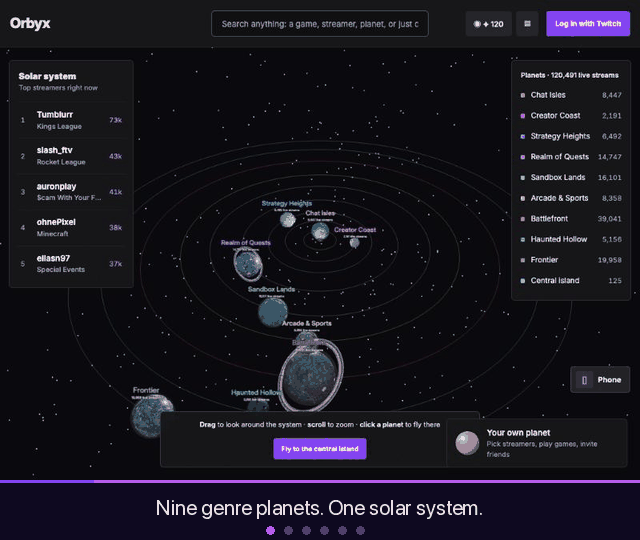
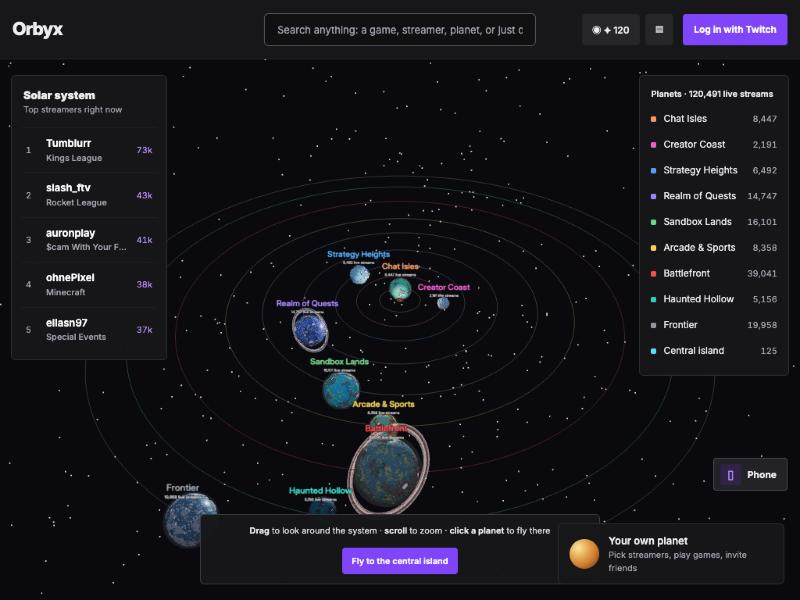
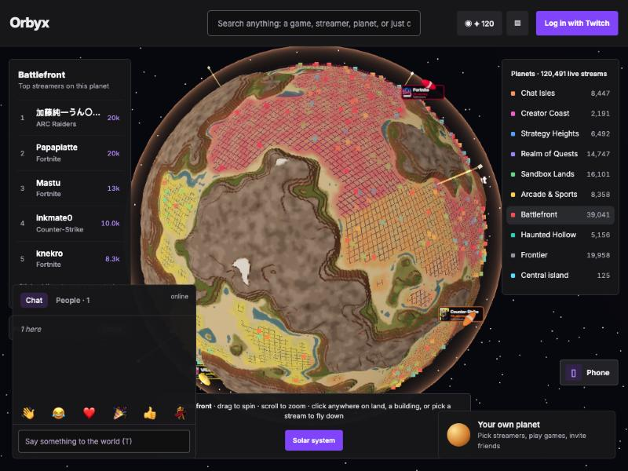
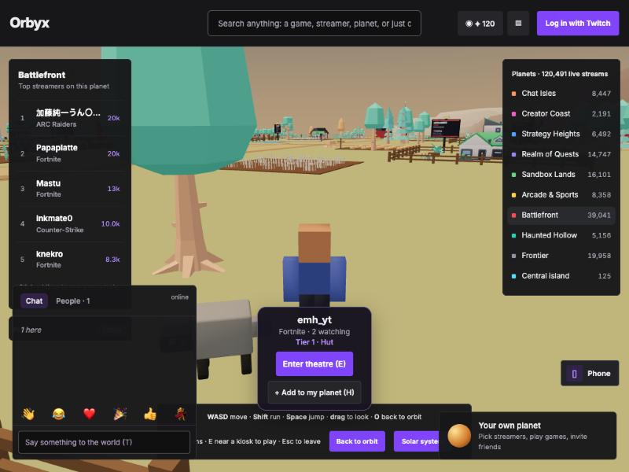
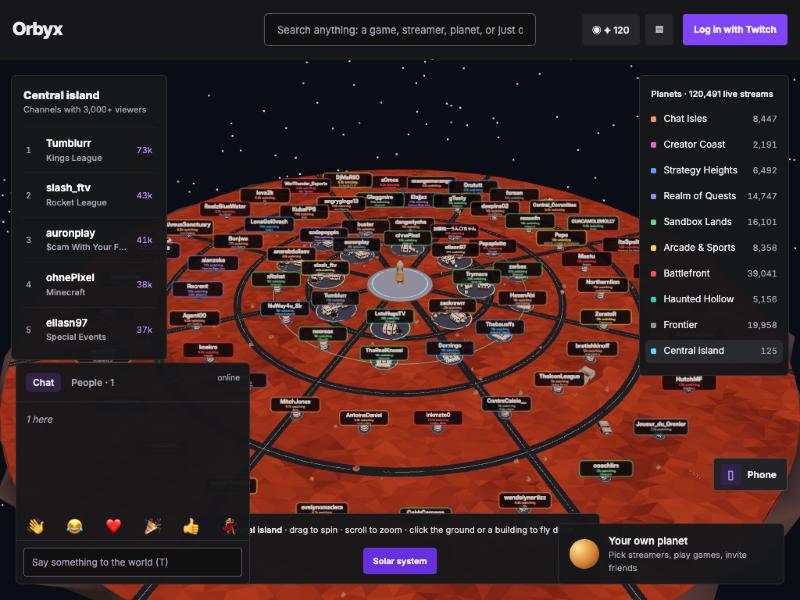
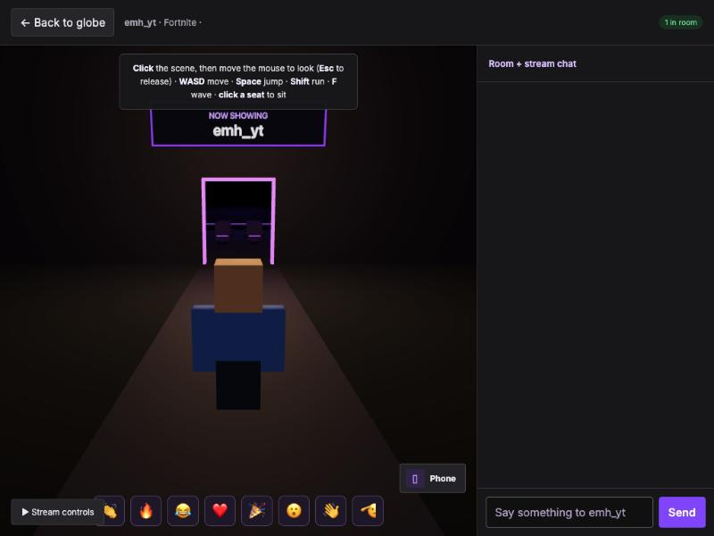
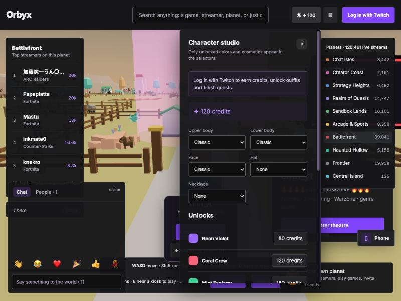
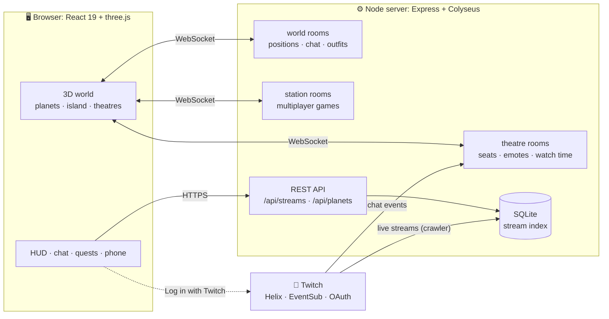
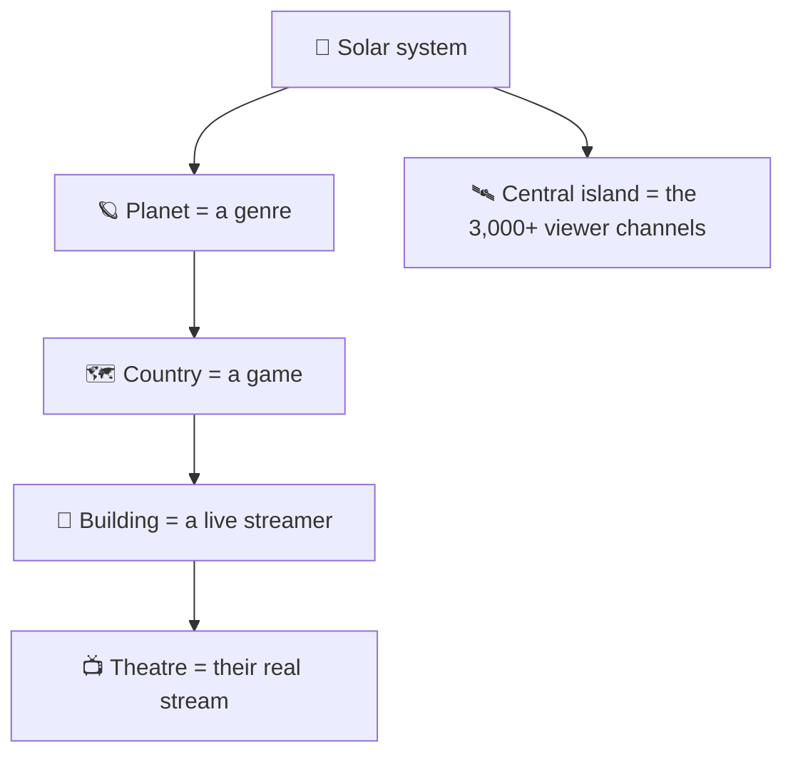

<div align="center">



<br/>

[](https://watchworld.onrender.com)
&nbsp;
[](https://dev.twitch.tv)


**[Tour](#-the-tour) · [Features](#-what-you-can-do) · [Screens](#-screens) · [How it works](#-how-it-works) · [Run it](#-run-it) · [Controls](#-controls) · [How we built it](#-how-we-built-it)**


</div>

> **Your favourite streams have a new home.** Orbyx turns all of live Twitch into a walkable 3D universe. Every genre is a planet, every game is a country on it, and every live streamer is a building you can walk up to and step inside. Watch together, play together, and meet the people next to you, instead of staring at a list.

<br/>

## 🎬 The tour

<div align="center">

<br/>
<sub>Real captures from the app, running on live Twitch data.</sub>
</div>

> [!NOTE]
> **The hosted demo shows the top 5,000 live streams, not all of Twitch.** It runs on a free host with limited memory (512 MB) and no permanent disk, so we cap the stream index at 5,000 channels, busiest first. This is a hosting limit, not a limit of the app: run it yourself with `MAX_INDEXED_STREAMS` unset and Orbyx indexes every live stream it can fetch (well over 100,000 at peak), with every planet, building and name scaled to match.

> 👉 **Judges: no setup needed.** Open the [live demo](https://watchworld.onrender.com), click **Enter**, and scroll or drag around. The free host sleeps when idle, so the very first load can take about a minute.


## ✨ What you can do

<table>
<tr>
<td width="50%" valign="top">

### 🪐 A universe made of streams
Nine genre planets plus a **central island** for the biggest channels (3,000+ viewers). Buildings grow with the audience: hut, cottage, house, tower, skyscraper. Wonders, blimps carrying each game's box art, roads, trains and traffic are generated for every planet. **Drag a planet** along its orbit, zoom out to see the whole system, and spot the ringed worlds.

</td>
<td width="50%" valign="top">

### 🚶 Walk anywhere
Click any spot on a planet to fly down, then walk, run and jump. Click a building to see its stream, and **Enter theatre** to watch. Wonders are solid, you can never land in the sea, and the central island plays by the same rules.

</td>
</tr>
<tr>
<td width="50%" valign="top">

### 📺 Theatres
Step into a streamer's room and watch the real Twitch stream with other viewers. Take a seat, wave, send emotes and chat. Logged-in viewers write to the actual Twitch chat. The in-game **phone** keeps updates, messages, friends and your quest progress.

</td>
<td width="50%" valign="top">

### 🧑‍🤝‍🧑 Other people, for real
Everyone on a planet sees each other live, with world chat and a People list. Press <kbd>Q</kbd> next to someone for a card with emotes, a private message, a planet invite, add-friend and mute. **Outfits are shared**, so friends see your clothes, hat and necklace.

</td>
</tr>
<tr>
<td width="50%" valign="top">

### 🎮 Games on every planet
Four multiplayer games per planet, as game blocks in the streets: board games, pool, shooters with real projectiles and cover maps, and more. Walk up, press <kbd>E</kbd> and play with whoever is nearby.

</td>
<td width="50%" valign="top">

### 🏡 Your own planet
Pick favourite streamers, press **Add to my planet** on any building, search your planet and fly straight to a streamer, then send an **invite link**. Friends who open it visit your world. Your planet shows up in the corner as a card, always one click away.

</td>
</tr>
<tr>
<td colspan="2" valign="top">

### 🏆 Quests and rewards
Log in with Twitch to earn credits from quests: time in theatres, social goals, and the 15-minute **Hidden Gems** quest that sends you to small streamers on the planet you are standing on (small channels come up most often, so new streamers get found). Watch time is **counted by the server**, not the browser. Spend credits on outfits, hats and necklaces. The Character and Quests buttons are visible to everyone, and only logged-in players can use them.

</td>
</tr>
</table>


## 🖼 Screens

<div align="center">



**The solar system**<br/>
<sub>Zoom out to see every orbit, drag planets around, and spot the ringed worlds.</sub>

</div>

<br/>

<div align="center">



**A genre planet**<br/>
<sub>Every game is a country, every live streamer a building. Click the ground to fly down.</sub>

</div>

<br/>

<div align="center">



**Street level**<br/>
<sub>Walk up to any building to see its stream and step inside.</sub>

</div>

<br/>

<div align="center">



**The central island**<br/>
<sub>Every channel with 3,000+ viewers, by name, around the plaza.</sub>

</div>

<br/>

<div align="center">



**Theatres**<br/>
<sub>A shared room around the live stream, with seats, emotes and chat.</sub>

</div>

<br/>

<div align="center">



**Character studio**<br/>
<sub>Earn credits, then unlock outfits, hats and necklaces that everyone else sees.</sub>

</div>

<br/>


## 🧭 How it works





The realtime and REST contract is documented in [CONTRACT.md](CONTRACT.md), and the game catalogue in [GAMES.md](GAMES.md).


## 🚀 Run it

<details open>
<summary><b>Quick start (about two minutes)</b></summary>

<br/>

Use **Node.js 22.13+**.

```sh
npm run setup
cp server/.env.example server/.env
npm run dev
```

Open **http://localhost:5173**. One command starts Vite (5173) and the Express/Colyseus server (2567). Without Twitch credentials the server runs on seeded demo data, so everything works for a first look.

</details>

<details>
<summary><b>With real Twitch data and login</b></summary>

<br/>

1. Register a confidential application in the [Twitch developer console](https://dev.twitch.tv/console/apps).
2. Add the OAuth redirect URL exactly: `http://localhost:2567/auth/twitch/callback` (and for a deployment, `https://YOUR-SITE/auth/twitch/callback`).
3. In `server/.env` set `TWITCH_CLIENT_ID`, `TWITCH_CLIENT_SECRET`, `TWITCH_REDIRECT_URI` (optional on a deployment) and a long random `SESSION_SECRET`.
4. Restart and click **Log in with Twitch**. Scopes: `user:read:chat`, `user:write:chat`, `user:read:follows`.

Never commit `.env` or `server/data/`; both are gitignored.

</details>

<details>
<summary><b>Settings</b></summary>

<br/>

| Variable | Effect |
| --- | --- |
| `BOTS=0` / `VITE_BOTS=0` | No simulated bot residents or viewers: only real people appear. Used on the deployed site. |
| `MAX_INDEXED_STREAMS` | Caps how many live streams are indexed (unset means no cap). The hosted demo sets 5000 because the free host has only 512 MB of memory. |
| `DEMO_STREAMS=1` | Keep the labelled demo streamers alongside real data. Off by default, so a real Twitch index never shows invented channels. |
| `PUBLIC_URL`, `ALLOWED_ORIGINS` | The public address and any extra allowed origins (Render fills the first in itself). |

See [DEPLOY.md](DEPLOY.md) for the Render and Docker setup.

</details>

<details>
<summary><b>Tests and build</b></summary>

<br/>

```sh
npm run build                  # server and web
npm --prefix server test       # realtime end-to-end checks
npm --prefix server run test:catalog
npm --prefix server run test:twitch
```

</details>

## 🎛 Controls

| Key | Action |
| --- | --- |
| <kbd>W</kbd> <kbd>A</kbd> <kbd>S</kbd> <kbd>D</kbd> · <kbd>Shift</kbd> · <kbd>Space</kbd> | Walk, run, jump |
| Mouse (click the scene first) · <kbd>Esc</kbd> | Look around, release the mouse |
| <kbd>O</kbd> | Back up to orbit |
| <kbd>T</kbd> | World chat |
| <kbd>1</kbd>–<kbd>6</kbd> | Emotes |
| <kbd>Q</kbd> | Talk to the person next to you |
| <kbd>H</kbd> | Add the building you are near to your planet |
| <kbd>E</kbd> | Enter a theatre or use a game block |
| Drag a planet · scroll | Move it along its orbit · zoom the system |


## 🛠 How we built it

Orbyx was built by a team of two with AI coding tools, each used for different parts:

- **Codex (OpenAI):** the multiplayer station-games system (the four games per planet, game engines and the 3D variants), written from the brief in [STATIONS_PROMPT.md](STATIONS_PROMPT.md) and [STATIONS_UPDATE_PROMPT.md](STATIONS_UPDATE_PROMPT.md); and the avatar, quest, in-theatre phone and Twitch-follows features.
- **Claude Code (Anthropic):** the sphere world renderer (planets, terrain, roads, wonders, blimps), the central island, custom planets, viewer crowds, player interactions, rewards fixes, deployment and the review and testing passes.
- **[Team to confirm before submitting: which tool wrote the original Express/Colyseus backend, the catalog and the theatre rooms.]**

## 🙏 Credits

Third-party models and their licences are listed in [CREDITS.md](CREDITS.md). Twitch is a trademark of Twitch Interactive; Orbyx is an independent project and is not affiliated with Twitch.

<div align="center">
<br/>

<sub>Made with ♥ for the Codex × Twitch hackathon · <b>Don't just watch. Be there.</b></sub>
</div>
